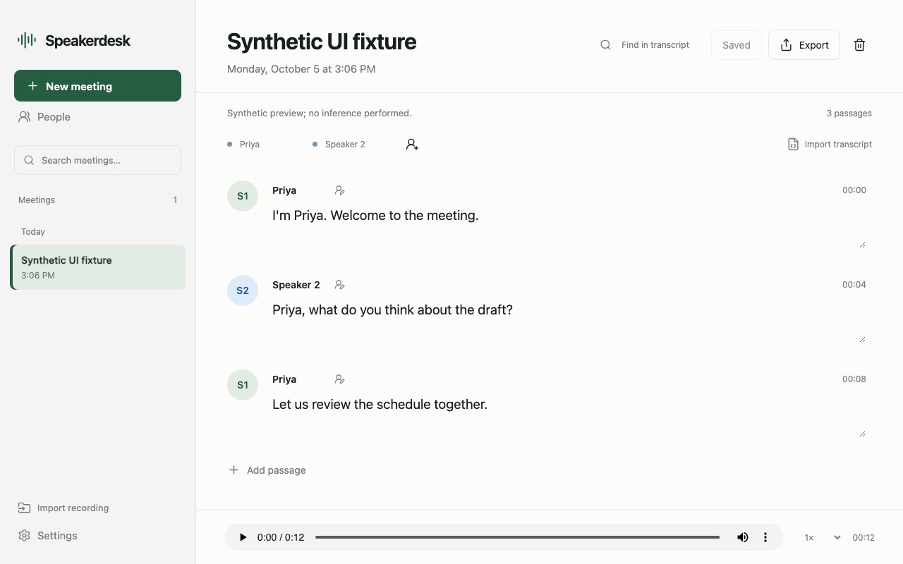
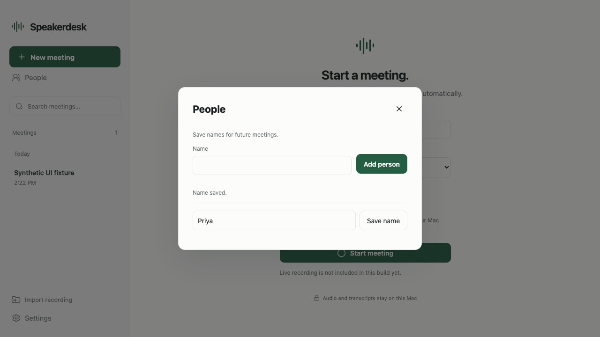
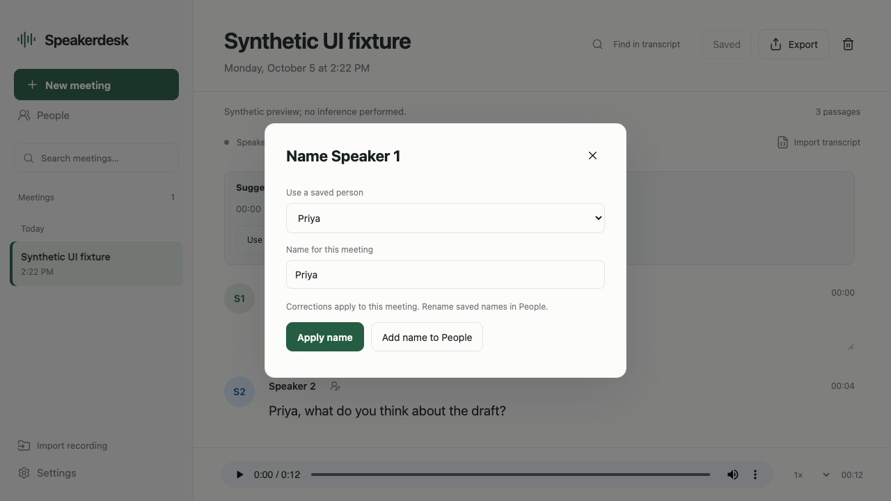

# Speakerdesk

Private meeting transcription and speaker labeling for Apple Silicon Macs, using NVIDIA Nemotron 3 diarization and Cohere Transcribe through MLX. Audio stays on the Mac; the app downloads pinned public model checkpoints during explicit setup. No paid transcription API is required.

The desktop shell uses Tauri, a native Rust host and inference child, and a Swift microphone/system-audio capture helper. macOS 15 or newer and an Apple Silicon processor are required. Allow roughly 4.1 GB for model setup including prepared timing weights and additional space for recordings. The core models occupy about 1.8 GB; the current timing provider adds about 1.7 GB including prepared GPU weights. This source repository contains no recordings, model weights, credentials or prebuilt application.

## Interface previews

These previews use invented names and transcript text with silent fixture audio. Native capture and model inference were not run for these screenshots. Meeting and name-picker images follow your GitHub light or dark appearance.

### Meeting

Review speaker names, edit passages and export the transcript.

<picture>
  <source media="(prefers-color-scheme: dark)" srcset="docs/screenshots/meeting-dark.jpg">
  
</picture>

### People

Save names for future meetings.



### Name picker

Choose a saved person or apply a name to this meeting.

<picture>
  <source media="(prefers-color-scheme: dark)" srcset="docs/screenshots/name-picker-dark.jpg">
  
</picture>

## Development

Install Node.js 24, Rust 1.99.0, Python 3.13, and Apple command line tools.
Python is used only by build and test tools; the application runs native code.
For a runnable desktop app, use the Apple build below and its setup control to
download pinned models.

The focused CPU/native checks do not download models or record audio:

```sh
python3 -m pip install -r requirements-ci.lock.txt
python3 -m unittest discover -s tests -v
python3 scripts/check_source.py
cargo test --locked --features speakerdesk-host/fixtures -p speakerdesk-core -p speakerdesk-host -p xtask
cargo xtask ownership --check
```

On macOS, the Python suite also executes the Swift capture-format, converter,
startup and epoch checks with generated buffers. Model numerical references
remain independent fixtures; their provenance is recorded beside each fixture.

## Apple builds

`Apple package` is a manual GitHub Actions workflow. Its default ad-hoc mode produces private test artifacts. Ad-hoc signing does not establish trusted distribution or notarization. Exact candidate signing/notarization uses the separate approved AppleRelease workflow with existing central Apple credentials; see [credential reuse](docs/credential-reuse.md). No secrets are provisioned by the producer and no release is published.

```sh
APPLE_SIGNING_IDENTITY="existing Developer ID identity" ./scripts/build_macos.sh
```

Local real-model streaming has been exercised on synthetic two-voice speech. CPU CI checks timing, lifecycle and access controls; it does not prove noisy-meeting accuracy, native capture quality or packaged-model parity. Live text replaces stable canonical utterances; Stop performs bounded larger-context refinement while preserving human edits and original audio. NVIDIA supplies independent speaker activity and Cohere supplies all words. Required supplied-text timing covers all fourteen configured languages, with independent coarse accuracy calibration in English. CJK character units and unsupported or uncertain units remain explicit; their ownership is never inferred from missing timing. Setup verifies the timing provider before admitting transcription, and a runtime failure keeps existing text while exposing a retry. Exported passage times are retained audio anchors. See [canonical protocol](docs/silero-canonical-protocol.md) and [alignment scope](docs/alignment-integration-status.md).

Public releases require notarization and native-package qualification. [Release acceptance](docs/core-acceptance.md) records that process; [download delivery](docs/download-contract.md) describes the stable installer and updater handoff.

People saves reusable local names; corrections and confirmed introduction suggestions apply to the current meeting. Native ReDimNet uses Core ML with the measured `CPU_AND_GPU` policy; mixed execution is allowed. Explicit enrollment and background recognition share the resident inference child. Uncertain speakers keep their current label. Choose Remember voice explicitly to save a profile; automatic matches never create or update profiles. Incompatible saved profiles remain intact and require consented replacement before recognition. Native startup discovers the legacy library before creating its store, and metadata-only voice-check revisions preserve pending editor saves; see [current status and evidence](docs/rust-port/implementation.md).

Model and source attributions are recorded in [packaging/THIRD_PARTY_NOTICES.md](packaging/THIRD_PARTY_NOTICES.md). The Mac build collects dependency notices into one generated app resource, available from Settings. NVIDIA's checkpoint uses OpenMDW 1.1; Cohere's checkpoint uses Apache 2.0. Model licenses remain applicable when downloading weights separately.
